# CHANKI KIM TRIAD 포트폴리오

React와 Three.js로 구현한 김찬기의 개발자 포트폴리오입니다. 제품과 사용자, 시스템과 개발 프로세스, 인터랙션과 실험의 세 공간에서 95개 프로젝트·개발 사례를 탐색합니다. 기존 건축과 49개 프로젝트 위치는 유지합니다.

## 프로젝트 탐색과 상세

- 전체 프로젝트에서 95개 항목을 검색하거나 49개 그룹 위치를 탐색합니다. 그룹 내부의 개별 프로젝트도 직접 선택할 수 있습니다.
- 가까운 작품을 직접 클릭하거나 전체 프로젝트 목록에서 선택하면 설명을 엽니다. 좌측의 프로젝트명·열기 버튼과 방 소개 캡션은 제거했고, 주변 작품 감지는 하단 페이지네이션의 현재 위치에 반영합니다.
- 프로젝트를 선택하면 전체 너비의 3D 공간에서 카메라가 정면으로 이동합니다. 최종 프레임을 보여준 뒤 전체 화면의 평면 상세 페이지가 페이드인합니다.
- 상세의 이전·다음 버튼은 같은 페이지에서 그림과 설명을 즉시 교체합니다. 카메라는 움직이지 않으며, X로 닫으면 마지막으로 선택한 작품 앞으로 즉시 배치합니다. 상세의 ‘공간으로 돌아가기’ 버튼은 제거했습니다.
- 기본 상세 화면은 크림톤의 그림 우선 구성입니다. 왼쪽 그림·체험 영역은 고정되고, 오른쪽에는 프로젝트 요약·담당 역할·문제와 제약·핵심 구현·결과와 근거가 표시됩니다. 95개 항목마다 작성한 개별 개발 설명을 유지합니다.
- ‘프로젝트 체험’은 왼쪽 영역에서 실제 iframe을 실행합니다. ‘크게 보기’로 설명을 접고 전체 화면에서 조작할 수 있습니다. 그림·체험 전환과 화면 크기 변경에도 같은 iframe을 유지하고, 프로젝트 변경·목록·닫기에서는 제거합니다. 닫기는 iframe 바깥에 항상 표시합니다.
- 체험 URL이 없는 프로젝트는 전환 탭 없이 그림과 개발 설명만 표시합니다. 화면 자료·캡처 뷰어와 관련 로딩·동기화 코드는 제거했습니다.
- 기존 벡터 표지 39점과 진열장 모형 10개를 검수된 그림 49점으로 교체했습니다. 앞면 프레임과 매트 없이 3cm 측면의 캔버스로 표시합니다. 일반 캔버스는 가로 1.65m, 끝 벽은 2.25m, 진열장은 1.02m이며 원본 7:5 비율을 유지합니다.

원본 배치·데모 주소는 [위치별 계획](docs/portfolio-spatial-plan.md)과 [주소 확인 보고서](docs/portfolio-iframe-audit.md)를 따릅니다. 승인된 프로젝트 목록은 `node tools/sync-portfolio.mjs`로 다시 동기화합니다. 개발자용 설명은 `src/data/project-stories-01.json`, `project-stories-02-03.json`에서 관리하고 런타임에서 개별 항목에 결합합니다.

[구현과 검증 기록](docs/portfolio-implementation.md)에 현재 범위와 피드백 반영 내용을 정리했습니다.

| 그림 우선 상세 | 전체 화면 웹앱 체험 |
|---|---|
| 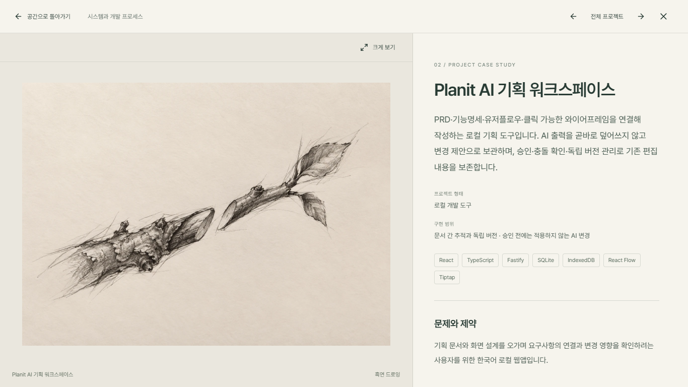 | 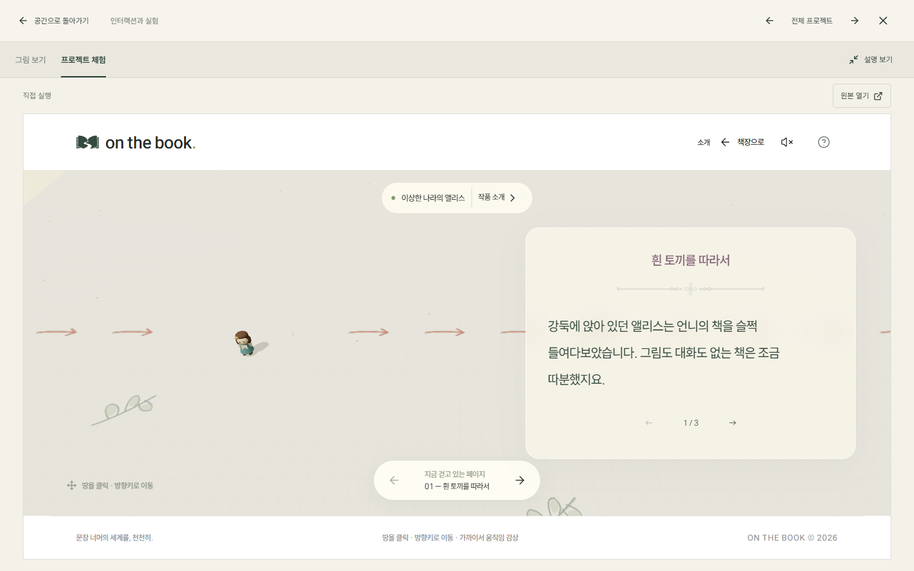 |

| 제품과 사용자 | 시스템과 개발 프로세스 | 인터랙션과 실험 |
|---|---|---|
| 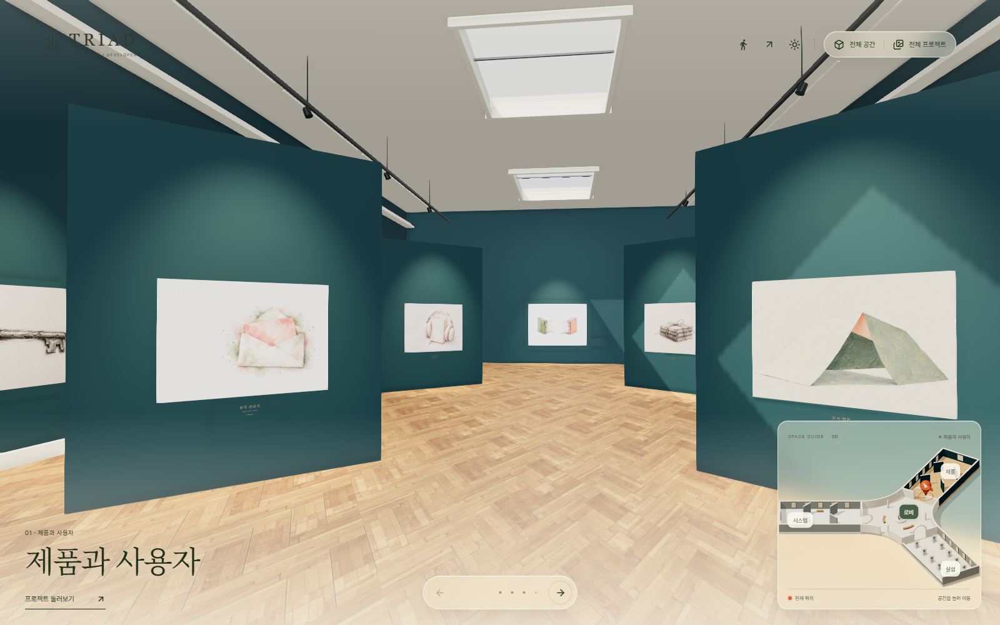 | 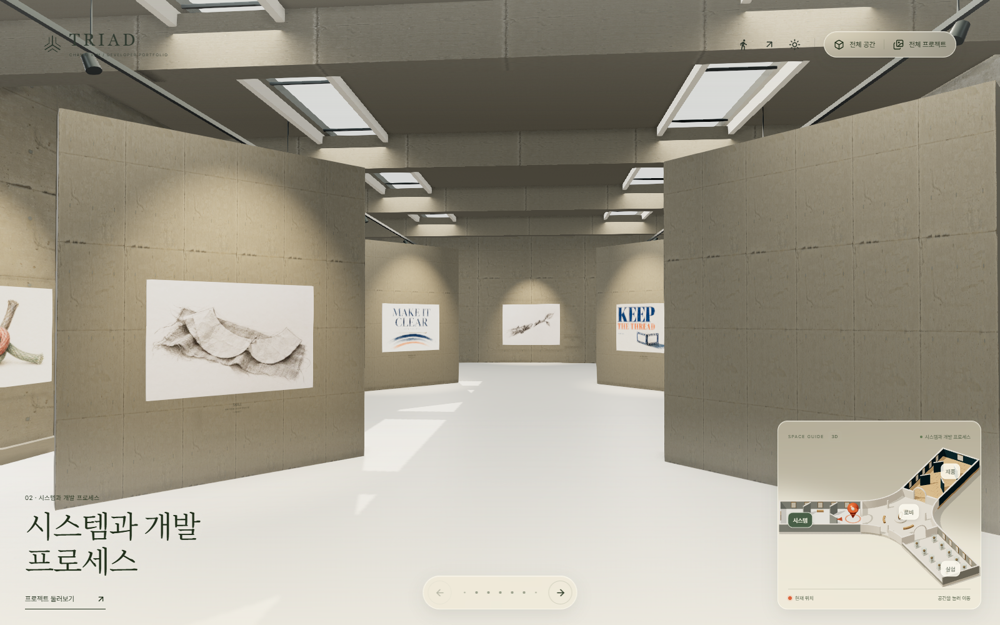 | 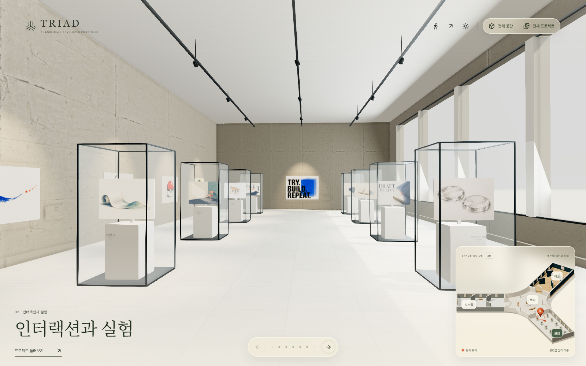 |

## 그림 자산 관리

검수된 원본과 평가 기록은 `output/portfolio-paintings-2026-10-20/`에 보존합니다. `npm run prepare:paintings`가 원본 해시와 검수 상태를 확인하고 전시용 742×530·상세용 1484×1060 WebP 및 `src/data/painting-assets.json`을 생성합니다. 전시용 전체는 약 3MB이며 상세용은 선택 시에만 불러옵니다. 그림 매핑은 프로젝트 동기화와 별도로 유지합니다.

## 건축 미리보기

아래는 기존 건축과 재료를 확인한 화면입니다. 포트폴리오 전환 후에도 이 공간 배치를 유지합니다.

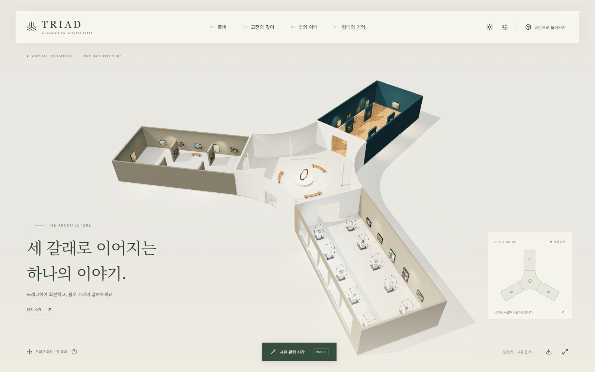

| 중앙 로비                                                                    | 고전의 깊이 · Concept 01                                                             |
| ---------------------------------------------------------------------------- | ------------------------------------------------------------------------------------ |
| 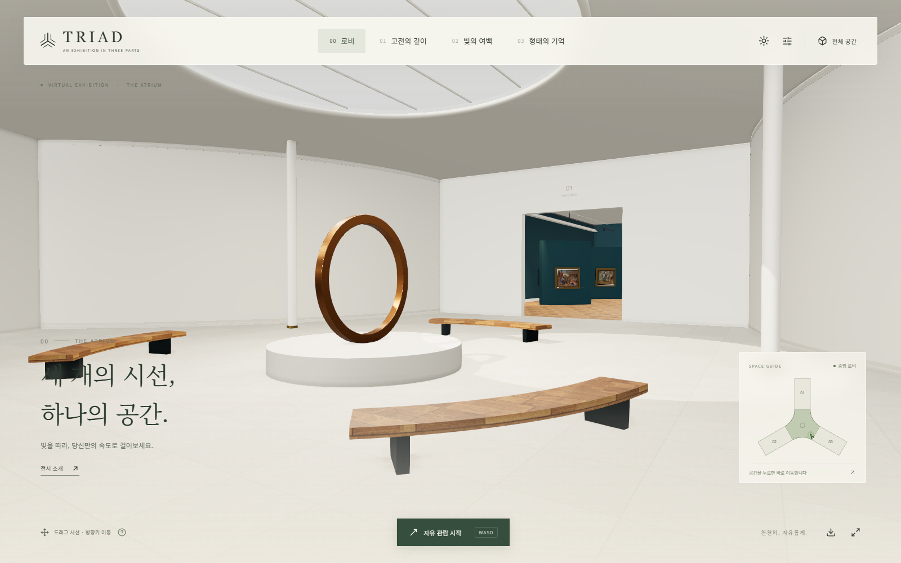 | 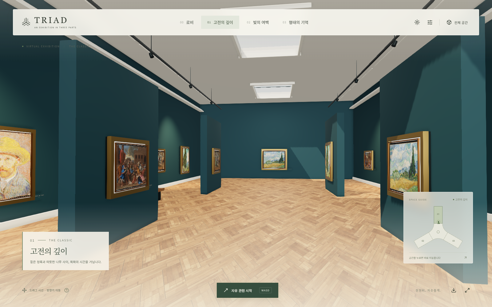 |

| 빛의 여백 · Concept 02                                                               | 형태의 기억 · Concept 03                                                              |
| ------------------------------------------------------------------------------------ | ------------------------------------------------------------------------------------- |
| 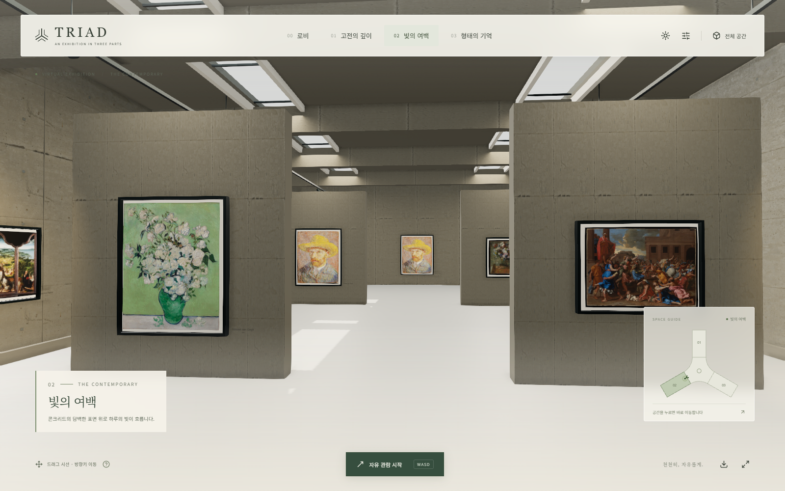 | 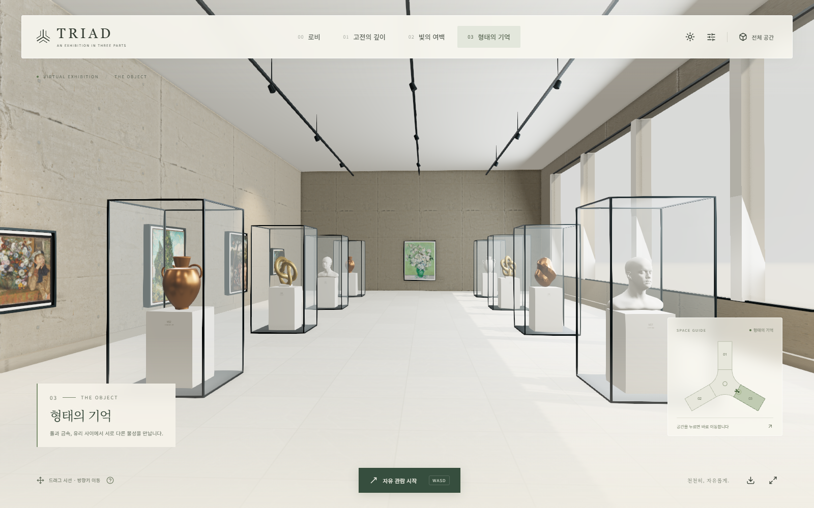 |

<details>
<summary>모바일 관람 화면</summary>

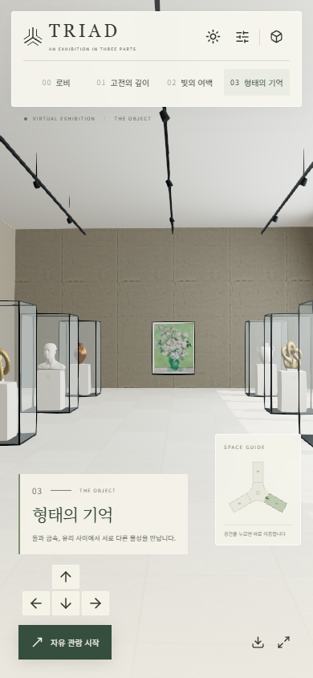

</details>

원본 PNG 6장은 [소개용 화면 캡처](docs/screenshots/)에서 내려받을 수 있습니다.

## 실행

로딩 화면은 21st.dev에서 전달받은 네 개의 입체 박스 애니메이션을 사용합니다. 다운로드 개수로 계산하던 퍼센트는 제거하고, 실제 자산 로딩·공간 구성·조명 셰이더 준비·첫 화면 렌더링 단계를 표시합니다. 동작 줄이기 설정에서는 박스를 정지시키며, 로딩 실패 시 다시 불러오기 버튼을 표시합니다. 전시 화면 왼쪽의 TRIAD 로고와 소개·작품 캡션은 제거했습니다. 작품은 직접 클릭하거나 전체 프로젝트 목록에서 열 수 있습니다.

UI 컴포넌트의 기본 경로는 `src/components/ui/`이며 `@/components/ui`로 불러옵니다. 스타일은 `src/styles.css`, 로더 전용 스타일은 `src/components/ui/box-loader.css`입니다. `components.json`과 Vite·TypeScript의 `@/*` 별칭을 맞춰 shadcn CLI가 같은 UI 폴더에 컴포넌트를 설치하도록 구성했습니다. Tailwind 4의 Vite 플러그인과 TypeScript를 설치했으며, 기존 화면의 기본 스타일을 유지하도록 Tailwind의 전역 Preflight 초기화는 가져오지 않습니다. 추가 컴포넌트는 `npx shadcn@latest add <이름>`으로 설치하고 `npm run typecheck`로 새 TypeScript 컴포넌트를 확인합니다.

중앙 모델은 `npm run prepare:black-hole`로 원본 `public/assets/black_hole.glb`에서 `black_hole.optimized.glb.gz`를 재생성합니다. 기존과 같은 오차 한도 0.00005의 지오메트리 단순화를 브라우저 대신 준비 단계에서 수행하고, 사용되지 않는 정점을 정리합니다. 원본 재질·텍스처 인덱스·내장 PNG는 그대로 보존합니다. 전송 크기는 31,304,284바이트에서 15,813,960바이트로 줄었습니다. 원본을 교체하면 이 명령도 다시 실행해야 합니다.

초기 셰이더 준비는 실제로 표시할 모든 방의 메시만 대상으로 하며, 별도 광학 렌더러에 속하는 숨겨진 블랙홀 재질을 전시관의 모든 조명으로 중복 컴파일하지 않습니다. 그림·중앙 모델·재질을 병렬로 읽고 사용하지 않는 목재 노멀·거칠기와 석재 노멀 텍스처는 받지 않습니다. 미니맵은 전시관 준비가 끝난 뒤 초기화합니다. 개발 환경의 `window.__TRIAD__.state().loadingTimings`에서 실제 단계별 경과 시간을 확인할 수 있습니다. 시간은 기기·캐시·네트워크에 따라 달라집니다.

추가 최적화에서는 16개 작품 조명과 모든 면광원의 계산식·개수를 유지하면서 GLSL 루프로 처리해 동일한 조명 계산을 조명마다 길게 복제하는 컴파일 부담을 줄였습니다. 그림자가 있거나 텍스처를 투영하는 스포트라이트는 기존 셰이더를 유지합니다. 첫 프레임의 광학·AO·색 보정·안티앨리어싱 셰이더를 실제 렌더 패스의 설정으로 함께 컴파일하며, 이 준비 과정에서는 픽셀을 그리지 않고 버퍼·시간 누적 상태를 복구한 뒤 완성된 첫 화면을 표시합니다. 해상도, 샘플 수, 효과 단계와 그림자 설정은 유지합니다.

실내 반사 환경은 `public/assets/gallery-environment.bin.gz`에 기존 RoomEnvironment·sigma 0.035의 768×1024 half-float CubeUV 데이터를 저장해 매번 GPU에서 재생성하지 않습니다. `npm run prepare:environment`는 실행 중인 개발 서버와 Chrome을 사용해 다시 생성합니다. Three.js의 환경 생성 방식을 변경하면 이 자산도 재생성해야 합니다. `node tools/verify-first-frame.cjs`는 각각 새 브라우저에서 이전 파이프라인과 최적화 후를 비교하고, 낮·저녁 8개 전시 화면의 픽셀 및 고화질 관람 성능을 확인합니다. 로컬 1366×768에서 첫 화면은 8.67초→3.66초, 관람은 양쪽 모두 60fps였습니다. 반사 환경의 3,145,728개 half-float 값은 같은 GPU의 원래 생성 결과와 모두 일치했습니다. 픽셀 비교에서는 UI와 시간 누적 중인 블랙홀 중심을 제외하며, 결과는 `output/browser-checks/first-frame/comparison.json`에 저장합니다.

`node tools/verify-loading.cjs`는 데스크톱·모바일의 로더, 동작 줄이기, 퍼센트 제거, 초기 미니맵 지연, 95개 프로젝트 목록, 전체 공간 전환과 로딩 실패 후 재시도를 확인합니다. 기본 개발 주소는 4191이며 `PORTFOLIO_URL`, `PLAYWRIGHT_MODULE`, `CHROMIUM_PATH`로 환경을 바꿀 수 있습니다. 결과와 화면은 `output/browser-checks/loading/`에 저장합니다.

Node.js 22.12 이상이 필요합니다. 현재 확인한 환경은 Node.js 24입니다.

```sh
npm install
npm run dev -- --host 127.0.0.1 --port 4183 --strictPort
```

브라우저에서 http://127.0.0.1:4183 을 엽니다. WebGL 2와 하드웨어 가속을 지원하는 최신 브라우저를 사용합니다.

```sh
npm run build
npm run preview -- --host 127.0.0.1 --port 4184 --strictPort
npm test
```

## 관람

- 작은 지도로 로비와 전시실 사이를 이동합니다. 하단에는 이전·다음 버튼과 점 표시로 구성된 작은 페이지네이션을 배치했습니다. 우측 상단의 ‘전체 공간’·‘전체 프로젝트’은 같은 아이콘·텍스트 스타일의 버튼 그룹입니다. 미니맵과 버튼 그룹, 페이지네이션은 같은 반투명 배경과 블러를 사용하며, 낮·저녁 조명에 맞춰 함께 바뀝니다.
- 페이지네이션은 전시된 49개 작품 위치를 승인된 순서대로 둘러봅니다. 점 표시는 현재 작품 주변의 최대 7점만 보여주며, 숫자 카운터는 표시하지 않습니다. 선택한 점이 가운데로 오도록 주변 점과 진행 링이 함께 좌우로 부드럽게 이동하며, 이동 중 다시 선택해도 현재 위치에서 새 방향으로 이어집니다. 페이지네이션에 포커스한 상태에서는 좌우 방향키로 탐색하고 Home·End로 처음·마지막 작품으로 이동합니다.
- 활성 점 둘레의 진행 링은 카메라의 실제 경과 시간과 총 이동 시간에 맞춰 채워집니다. 다른 작품으로 재탐색하면 처음부터 시작하며, 도착하면 링이 완성된 뒤 잦아듭니다. 운영체제의 동작 줄이기 설정에서는 이동과 진행 표시가 즉시 완료됩니다.
- ‘전체 프로젝트’는 프로젝트명·공간·실행 형태를 표시하는 전체 화면 목록을 엽니다. 검색과 그룹별 탐색을 지원합니다. 공간에서 처음 선택하면 정면 이동 후 상세가 열리고, 상세 안에서 다른 프로젝트를 선택하면 내용만 즉시 바뀝니다.
- 중앙 로비에는 두께가 있는 아치형 출입구, 곡선 벽의 아치 장식과 몰딩, 장식 기둥, 격자 유리 돔을 적용했습니다. 출입구 폭은 4m를 유지하며 돌출 장식과 기둥 하부에도 이동 충돌 처리를 적용합니다.
- 우측 하단 지도는 천장을 걷어낸 입체 모형입니다. 실제 도면의 곡선 로비·전시벽·가구 배치를 반영하며, 주황색 3D 핀과 바닥 화살표가 현재 위치와 시선 방향을 나타냅니다. 공간 바닥이나 이름을 누르면 이동하며, 이름은 키보드로도 선택할 수 있습니다.
- 드래그로 시선을 돌리고 WASD 또는 방향키로 걷습니다. 기본 이동 속도는 초당 4.5m이며, Shift를 누르면 초당 7.5m로 빠르게 이동합니다.
- 데스크톱 상단의 걷는 사람 아이콘을 누르면 마우스로 시선을 자유롭게 움직입니다. Esc로 종료합니다.
- 휴대폰에서는 터치 드래그로 시선을 돌리고 페이지네이션·미니맵·전체 프로젝트 목록으로 이동합니다.
- 페이지네이션으로 프로젝트를 선택하면 전체 너비의 3D 화면에서 벽·패널·가구를 피해 해당 위치로 이동합니다. 목록의 항목이나 가까운 작품을 직접 누르면 정면 정렬 뒤 상세 페이지를 엽니다.
- 정면 이동과 240ms 정면 유지 뒤 상세 페이지가 380ms 동안 페이드인합니다. 폭 1100px 미만에서는 그림·체험 아래에 설명을 배치합니다. 확대 모드는 전체 가용 화면에서 원본 전체를 표시합니다.
- 상세 헤더의 이전·다음 버튼과 전체 프로젝트 목록은 내용을 즉시 교체합니다. 상세를 닫으면 마지막으로 선택한 작품 앞으로 즉시 배치합니다. 최초 정면 이동 중 Escape로 취소하면 진입 전 위치·시선·화각으로 돌아갑니다. iframe 내부의 Escape 전달에 의존하지 않습니다.
- ‘전체 공간’에서는 천장을 걷어낸 모형을 회전·확대할 수 있습니다. 첫 전환 시 멈춤을 줄이기 위해 그래픽 프로그램을 미리 준비하고, 전체 보기에서는 추가 표면 음영 처리를 생략합니다.
- 해/달 버튼으로 환한 낮과 작품 조명을 강조한 어두운 저녁을 전환합니다. 화면 품질은 화면 크기와 렌더링 속도에 맞춰 자동 조절됩니다.

## 도면 반영

기본 치수는 `output/exhibition-design/v2/design-basis.json`의 R02 도면을 따릅니다. 현재 3D 배치는 `src/world/design-basis.json`의 R03이며, 전시벽 8개의 사선 회전을 추가했습니다. 3D 공간의 1단위는 1m입니다. 기존 R02 도면은 이전 배치 기록으로 보관합니다.

| 항목             | 반영 내용                                          |
| ---------------- | -------------------------------------------------- |
| 배치             | 중앙 로비 + 120° 간격의 세 갈래 전시실             |
| 각 전시실        | 내부 폭 12m × 길이 24m                             |
| 천장 높이        | 로비·01·03: 6m / 02: 5m                            |
| 벽·전시실 출입구 | 벽 0.3m / 출입구 4m × 4.2m                         |
| 로비             | 곡선 외벽, 원형 천창 Ø8m, 곡선 벤치 3개, 기둥 3개  |
| 중앙 조형        | 받침 Ø3.6m × 높이 0.45m / Black Hole 기본 폭 3.2m, 중심 높이 1.75m에서 접근 시 약 1.85배 확대 |
| 전시 패널        | 01·02 각각 4개, 높이 3.6m                          |
| 유리 전시함      | 03에 10개, 각 1.2m × 1.2m × 높이 2.4m              |
| 채광             | 01의 천창 3개, 02의 긴 천창 2개와 보, 03의 측면 창 |

01에는 청록색 벽, 헤링본 원목 바닥, 프레임 없는 캔버스와 천장 몰딩을 적용했습니다. 02에는 노출 콘크리트 벽, 회색 바닥과 긴 천창의 그림자를 적용했습니다. 03에는 밝은 석재 바닥, 검은 금속 프레임의 유리 전시함과 소형 캔버스를 배치했습니다.

01·02의 독립 전시벽은 각 전시실 입구에서 작품 면을 볼 수 있도록 좌우 대칭의 45도 사선으로 배치했습니다. 벽의 중심 위치와 3m 길이·0.3m 두께·3.6m 높이를 유지하며, 부착 작품·명패·바닥 음영과 충돌 범위도 같은 방향으로 회전합니다. 중앙에는 폭 3m의 연속된 보행 범위를 확보했습니다.

그림은 기존 배치 중심을 유지하고 7:5 비율의 큰 캔버스로 표시합니다. 진열장 캔버스는 유리 안쪽에 설치해 받침대와 천장에 닿지 않습니다. 벽·가구·진열장의 이동 충돌은 유지합니다.

## 모델과 재질

건축과 전시 가구 및 캔버스는 코드에서 생성하므로 별도 Blender 파일 없이 실행됩니다. 중앙 로비는 사용자 제공 `black_hole.glb`를 불러오며, 원래의 기울기와 텍스처를 유지한 채 기존 받침에 맞춰 배치했습니다. 구형 재질을 변환하고 원본 빛 텍스처의 앞면과 발광을 적용해 낮·저녁 조명 모두에서 표시합니다. 미니맵에도 간략한 블랙홀 모형을 반영했습니다. 질감은 프로젝트 내부에 저장된 실사 기반 재질이며, 표면 굴곡·거칠기·금속 반사·유리 투명도, 천창/창의 채광과 그림자, 물체가 바닥과 만나는 부분의 음영을 함께 사용합니다.

현재 구현은 브라우저에서 돌아가는 실시간 관람 공간입니다. 투명 유리는 성능을 고려한 표현이며 물리적으로 정확한 굴절·전역 조명 렌더링은 아닙니다. 휴대폰에서는 가벼운 품질을 기본 적용하고, 실제 기기 성능에 따라 부드러움은 달라질 수 있습니다.

중앙 블랙홀은 약 7.5m 안으로 다가가면 깨어나고 약 2.8m에서 가장 강하게 반응합니다. 중심을 눈높이 1.75m에 유지한 채 약 1.85배 커지고, 원반·안쪽 빛·원본 UV 무늬가 서로 다른 속도로 흐릅니다. 좁은 시야각의 별도 광학 카메라는 확대 중에도 전경이 근거리 클리핑 면에 닿지 않게 하며, 일반 관람 카메라에서는 수평 시선과 화면 내 위치를 유지합니다. 확대에 따라 천창·실내등·작품 조명이 어두워지고, 가장 가까운 거리에서는 UI 그라데이션도 사라져 검은 우주 배경으로 이어집니다. 물러나면 사용자가 선택한 낮/저녁 조명으로 돌아옵니다.

Sketchfab 공개 설정은 `black-hole-reference.json`에 보존합니다. 발광 2 / 0.6 / 0.2, 독립 알파 UV, 범프·광택, 굴절 IOR·색·표면 혼합, 색수차와 따뜻한 색 보정을 복원합니다. 원본 셰이더의 Lambert/GGX 분포·가시성·Fresnel 계산을 적용하여 앞쪽 금빛 입자의 반사를 유지합니다. 공개 모델이 참조하는 space LogLuv 환경과 부호가 포함된 구면조화 기저·환경 회전도 사용합니다. GLB에 이미 들어 있는 장면 방향을 중복 적용하지 않으며, 업로드된 기준 이미지에서 측정한 고리 비율과 시점을 별도 presentation 값으로 기록했습니다.

블랙홀만 검은 배경에 렌더링하여 전시관 벽이 주황색 굴절판으로 보이지 않게 합니다. 발광체와 반투명 원반을 먼저 한 번 그리고 그 색·깊이를 보존한 뒤 굴절층을 합칩니다. 별도의 가까운 표면 깊이·불투명도 버퍼는 투명도가 0인 왜곡 표면도 기록하여 번짐이 불필요한 면을 채우지 않게 합니다. 광학 카메라의 깊이 범위는 모델 경계에 맞춰 굴절 판정을 안정화합니다. 굴절은 일곱 단계 Gaussian 흐림을 사용하며, 미세한 알파 무늬는 Halton 지터와 이력 제한을 적용한 시간 누적으로 안정화합니다. 원본의 정규화된 깊이와 초점 거리를 사용하는 흐림을 번짐 전에 처리하고, 다섯 단계 번짐·색수차를 별도 광학 버퍼에 적용합니다. 전시관의 ACES 톤 매핑 다음에 원본 빛을 합쳐 다채로운 색이 흰색으로 단순화되지 않게 합니다. 번짐 강도는 다른 HDR 버퍼 형식에 맞춰 기준 이미지로 보정했습니다.

실내 GTAO는 블랙홀을 제외하므로 투명 표면을 불투명한 삼각형으로 잘못 그리지 않습니다. 내장 텍스처와 UV 경계를 유지하면서 지오메트리의 중복 삼각형을 줄이고, 광학 캡처의 색·깊이를 재사용합니다. 전체 공간·먼 거리·화면 밖에서는 가벼운 원본 텍스처 대체 표시를 사용합니다. 운영체제의 동작 줄이기 설정에서는 회전·UV 이동·맥동을 멈춥니다. 개발 서버의 `?perf=1`에서는 최근 120프레임의 속도·프레임 시간·호출 수·삼각형 수·접근 및 몰입 정도를 확인할 수 있습니다. 원본과의 최종 대조는 같은 화면 비율과 시점에서 진행하며, 원본 렌더러와 자체 구현의 픽셀 단위 일치를 보장하지는 않습니다.

## 확인 기록

- `npm test`: 이동·충돌·전시실 경로·카메라·조명 복원, 블랙홀 광학·재질·렌더링 실패 복원, 49개 캔버스·95개 프로젝트와 개발 설명·URL 정책·근접 감지를 함께 검사합니다.
- `npm run build`: 배포용 결과물 생성.
- `output/browser-checks/black-hole-final-verification.json`: 최종 반사·입자 질감과 첫 접근·낮/저녁·후퇴 복원 검증. 804×892에서 약 2.07m 근접 시 고품질 59.5–60fps, 약 79.9만 삼각형 처리. 1353×757에서는 약 3.07m에서 자동 경량 품질로 60fps, 약 73.6만 삼각형을 확인했습니다. `black-hole-fidelity-final.png`는 기준 이미지와 같은 1353×757 광학 비교 화면입니다. 기준과의 밝기 측정은 `black-hole-final-fidelity-comparison.json`에 기록했으며, 렌더러 차이로 픽셀 단위로 동일하지는 않습니다. 기기·화면에 따라 성능이 달라집니다.
- 이전 광학 구현 기록 `output/browser-checks/black-hole-native-settings-verification.json`: 1353×757에서 낮·저녁 근접 표시, 첫 접근, 후퇴 시 저녁 복원을 확인했습니다. 약 2.39m에서 59–60fps(경량 품질), 약 40.9만 삼각형 처리.
- 이전 구현 기록 `output/browser-checks/black-hole-performance-verification.json`: 804×892 화면에서 수정 전후 프레임 측정 및 첫 접근·낮/저녁 확인 기록. 약 3.8m 접근 지점에서 31.7fps(경량 품질) → 60fps(고품질), 로비 삼각형 처리량 214만 → 70만 개. 기기·화면 크기에 따라 결과는 달라집니다.
- 이전 구현 기록 `output/browser-checks/black-hole-color-restoration-verification.json`: 색 복원 후 약 3.5m에서 60fps(고품질), 약 43만 삼각형 처리. `black-hole-color-flow-a.png`·`black-hole-color-flow-b.png`에 같은 위치에서 흐르는 색 무늬를 기록했습니다.
- `output/browser-checks/verification.json`: 실제 Chromium 브라우저 기능 검사.
- `output/browser-checks/gallery-navigation-verification.json`: 페이지네이션·전체 프로젝트 목록·모달 복귀·데스크톱과 모바일 감상 화면 확인 기록. `pagination-*.png`, `collection-index-*.png`에 교체한 UI를 저장했습니다.
- `output/browser-checks/01-lobby.png`부터 번호가 붙은 이미지: 데스크톱과 모바일 화면 검수 자료.
- `node tools/verify-portfolio.cjs`: 현재 포트폴리오의 95개 검색·하위 선택·체험 유무에 따른 탭 표시·실제 웹앱 조작·종료·모바일 검수. 다섯 화면 크기의 그림 맞춤·확대 검사를 포함합니다. 기록은 `output/browser-checks/live-experience-only/report.json`에 저장하며 기본 주소는 4185입니다. `PORTFOLIO_URL`, `PLAYWRIGHT_MODULE`, `CHROMIUM_PATH`로 실행 환경을 지정합니다.
- `node tools/verify-nearby-caption.cjs`: 49개 위치의 자동 제목, 키보드 접근·이탈, 상세 열기·닫기와 다섯 화면 크기의 단어 단위 줄바꿈을 확인합니다. 기록은 `output/browser-checks/nearby-caption/`에 저장합니다.
- `tools/verify-browser.cjs`와 앞의 JSON·스크린샷은 포트폴리오 전환 전 건축·관람 UI 검사 이력입니다.
- 초기 구현용 검사 스크립트 `tools/verify-black-hole.cjs` (현재 광학 파이프라인은 단위 검사와 브라우저 실화면으로 검증): 중앙 블랙홀의 실제 로딩·크기·재질·낮/저녁 전환·모바일 표시 검사. Playwright가 설치된 도구 런타임에서 실행하며, 필요하면 `CHROMIUM_PATH`로 브라우저 경로를 지정합니다. `output/browser-checks/black-hole-*.png`와 `black-hole-verification.json`에 결과를 저장합니다.

재료와 작품의 저작권 및 출처는 [ASSET_LICENSES.md](ASSET_LICENSES.md)에 정리했습니다. 기본 글꼴은 로컬에 포함된 Pretendard Variable이며, 제목에는 Google Fonts의 Noto Serif KR을 사용합니다. 외부 연결이 없으면 제목은 시스템 글꼴로 표시합니다.

작품 감상 화면과 카메라 이동은 [my-world-01](https://github.com/blackstarzck/my-world-01/tree/0791c20)을 참고했습니다. 카메라의 속도·시선·화각 보간을 가져오고, 현재 전시장 도면의 충돌 영역에 맞춘 경로 탐색과 진입 시점 복귀를 적용했습니다.

작은 페이지네이션과 전체 화면 작품 목록은 [my-world-02](https://github.com/blackstarzck/my-world-02/tree/6d8f566)의 갤러리 탐색과 목록 레이아웃을 참고했습니다. 기존 49개 위치에 React UI와 카메라 제어를 연결하고, 정면 이동 후 전체 화면 상세가 열리는 순서를 적용했습니다.

상세 탐색과 닫기는 `node tools/verify-detail-navigation.cjs`로 검사합니다. `verify-camera.cjs`와 `verify-close-camera.cjs`도 같은 최신 검사를 실행합니다. 최신 결과는 `output/browser-checks/detail-navigation/report.json`에 있습니다. X는 마지막 작품 앞으로 즉시 배치하고, 최초 진입 애니메이션을 취소한 경우에는 진입 전 시점을 복원합니다. 공간 내 자동 이동의 경로·충돌 검사는 `node tools/audit-camera-routes.mjs`로 실행합니다.
