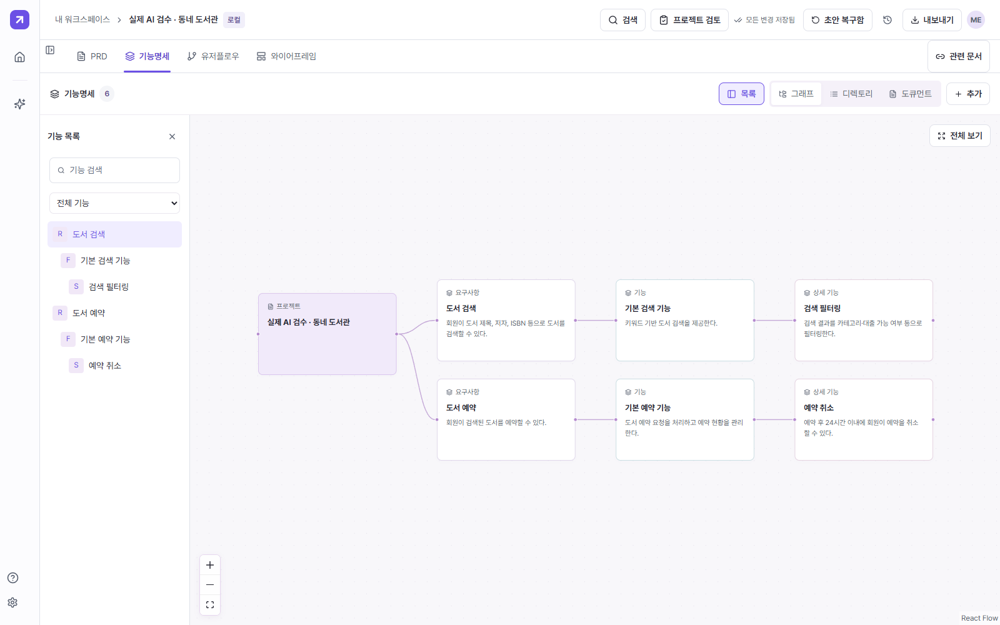

# Planit 로컬 실행 캡처

2026년 10월 19일 23시 4분경(KST), 기존 Planit 로컬 앱을 실행해 촬영한 화면이다. 전시 02의 ‘생각의 설계도’ 작품 자료로 사용한다.

| 화면 | 자료 |
|---|---|
| 대시보드 | [실행 화면](planit-dashboard.png) |
| PRD | [실행 화면](planit-prd.png) |
| 기능명세 | [실행 화면](planit-features.png) |
| 유저플로우 | [실행 화면](planit-flow.png) |
| 와이어프레임 | [실행 화면](planit-wireframes.png) |

포커스 시 PRD → 기능명세 → 유저플로우 → 와이어프레임을 선택·확대하는 캡처 뷰어를 제안한다. 대시보드는 작품 소개와 전체 흐름의 보조 이미지로 사용한다. 설명에 ‘로컬 앱 실행 화면 · 검수용 샘플 데이터’를 표시한다.

## 촬영 근거

- 앱 소스: [project-manager](https://github.com/blackstarzck/project-manager). 기존 로컬 빌드와 서버를 실행했다.
- 예제: 기존 QA 데이터의 ‘실제 AI 검수 · 동네 도서관’. 합성 예제로, 실제 고객 서비스나 고객 데이터로 소개하지 않는다.
- 원본 SQLite를 읽기 전용으로 열고 백업 API로 만든 별도 복사본을 사용했다. 복사 전후 원본 DB와 WAL의 해시가 동일했다.
- 촬영 실행 주소: http://127.0.0.1:43100. 임시 촬영 서버는 종료했다.
- 1600 × 1000 PNG 5장. 네 문서 화면과 대시보드를 눈으로 확인했으며 페이지 실행 오류는 없었다.
- AI 생성·저장 요청 없이 기존 화면을 열었다. 앱 소스·배포·원본 프로젝트 데이터는 변경하지 않았다.
- 로컬 서버는 X-Frame-Options: DENY를 반환했다. 공개 Vercel 문서의 API 404와 로컬 앱 동작은 구분한다.

화면별 촬영 정보는 [메타데이터](capture-manifest.json)에 기록했다.
