# 포트폴리오 회화 전체 보기

49개 전시 위치의 교체용 회화다. 각 그림에 서로 다른 전담 평가 에이전트 1명을 배정했고, 39점은 수정 없이, 10점은 한 차례 수정·재평가 후 통과했다. 그림마다 최대 두 차례 수정하도록 제한했다. 49점 모두 전시관에 적용했고, 프레임 없는 캔버스·그림 우선 상세·체험 전환을 검증했다.

화풍은 프로젝트별로 선택했다. 수채·아크릴의 참고 무드를 유지하고, 한 상징과 넓은 여백을 기본으로 삼았다. 복잡한 사례에는 포스터·팝아트를 사용했다.

[캔버스 확대와 프레임 제거 사양](../../docs/portfolio-painting-display-spec.md) · [전체 매핑](manifest.json) · [생성 프롬프트](generation-prompts.json) · [파일 검증](validation.json)

## 01 제품과 사용자

| 도토리 토픽 · 사용자단 · A01-01 | 도토리 토픽 · 관리자단 · A01-02 |
|---|---|
| 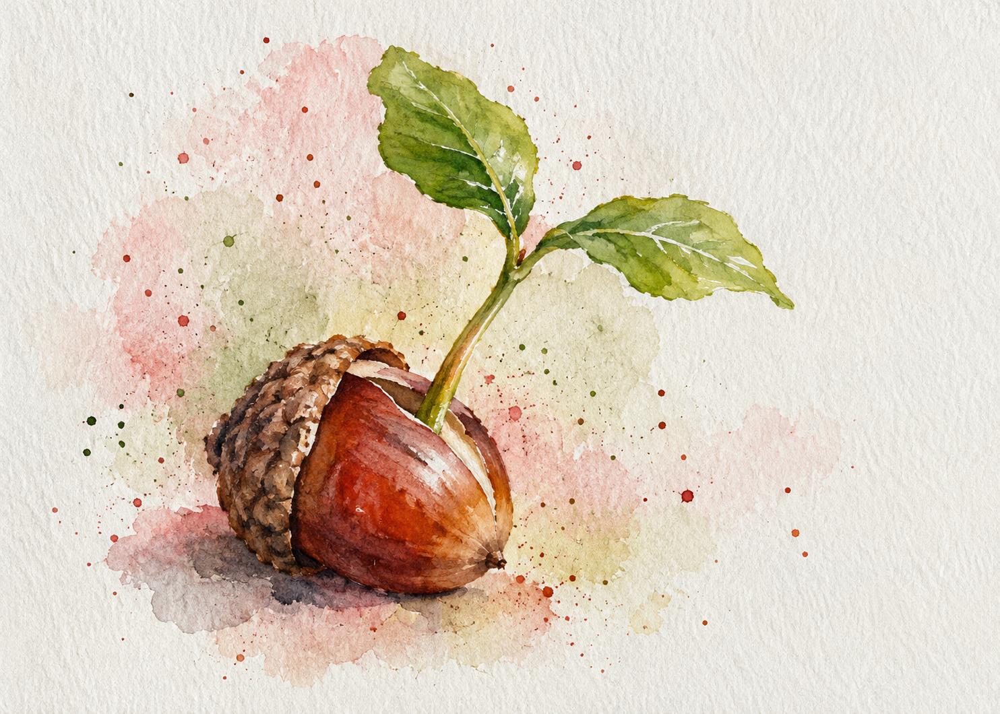 | 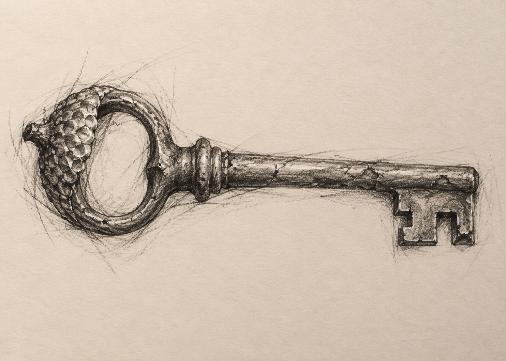 |
| 수채화 · 도토리와 새싹 | 흑연 드로잉 · 도토리 머리의 열쇠 |
| 수정 0회 · [평가 기록](reviews/A01-01.json) | 수정 0회 · [평가 기록](reviews/A01-02.json) |

| 도토리 문의 관리자 · P01-01-F | 교육 서비스 화면 연구 · P01-01-B |
|---|---|
|  |  |
| 수채화 · 열린 편지 | 타이포그래피 포스터 · 배움의 여러 자리 |
| 수정 1회 · [평가 기록](reviews/P01-01-F.json) | 수정 0회 · [평가 기록](reviews/P01-01-B.json) |

| 센서 3D 시각화 대시보드 · A01-03 | CONNECT BEE · A01-04 |
|---|---|
| 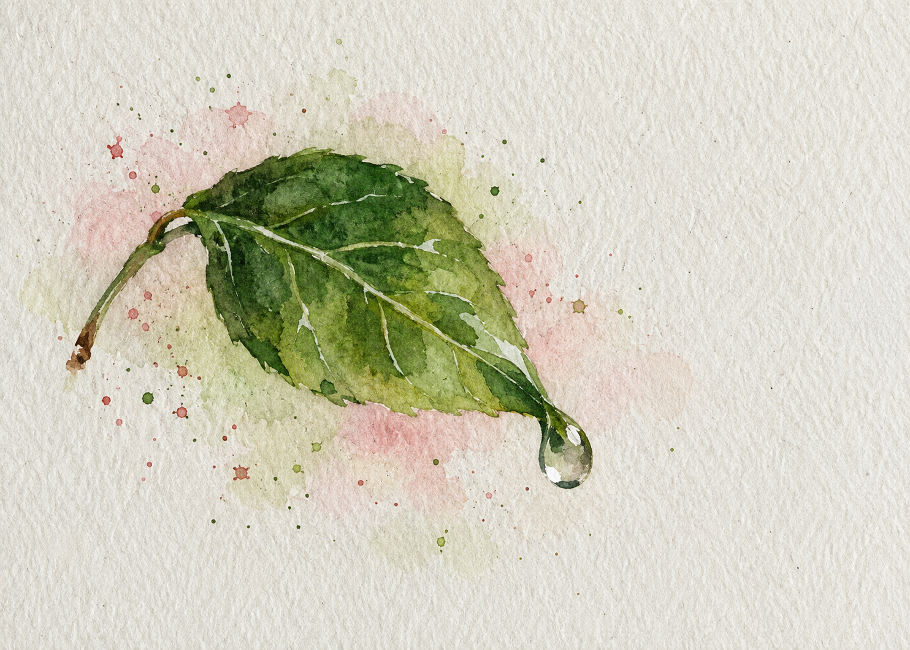 |  |
| 수채화 · 잎과 이슬 한 방울 | 아크릴 임파스토 · 꽃에 내려앉은 벌 |
| 수정 0회 · [평가 기록](reviews/A01-03.json) | 수정 0회 · [평가 기록](reviews/A01-04.json) |

| DADOKe 전자책 · 오디오북 · P01-03-F | 북차카 홈페이지 · P01-03-B |
|---|---|
|  |  |
| 아크릴 임파스토 · 책을 감싼 헤드폰 | 과슈·색연필 · 바퀴 달린 책 |
| 수정 1회 · [평가 기록](reviews/P01-03-F.json) | 수정 0회 · [평가 기록](reviews/P01-03-B.json) |

| 케듀올 홈페이지 · A01-05 | 부클리 홈페이지 · A01-END |
|---|---|
| 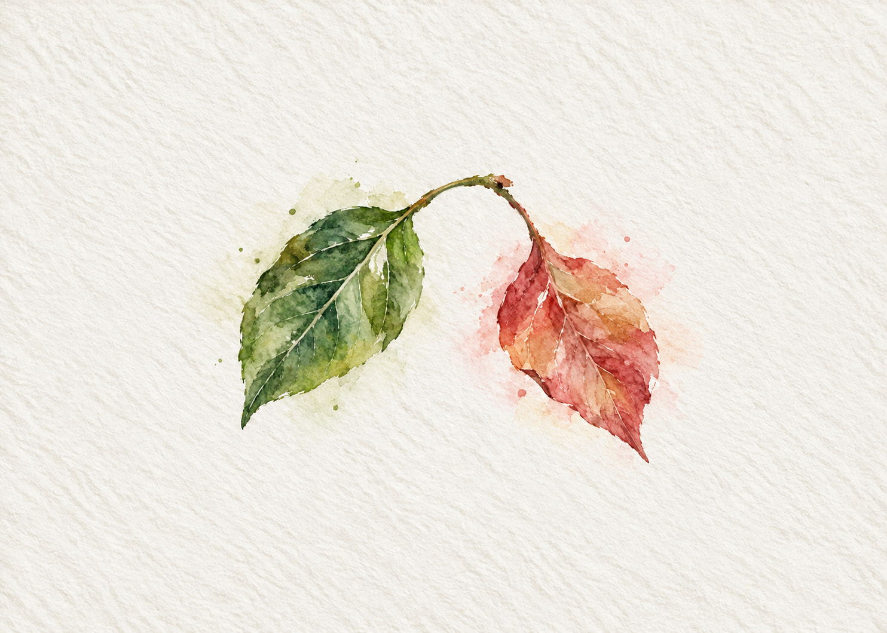 | 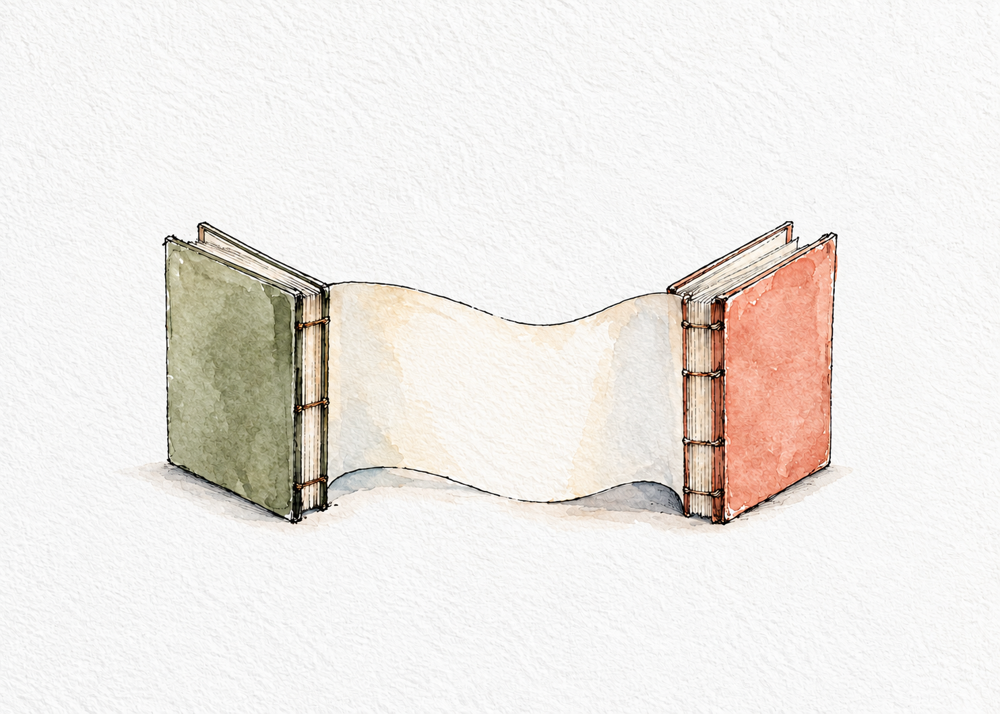 |
| 수채화 · 하나로 이어진 두 잎 | 펜·수채화 · 다른 제본의 같은 이야기 |
| 수정 1회 · [평가 기록](reviews/A01-05.json) | 수정 1회 · [평가 기록](reviews/A01-END.json) |

| 위즈덤셀러 홈페이지 · A01-10 | 글로윈 비나 홈페이지 · P01-04-B |
|---|---|
|  |  |
| 수채화 · 종이배의 첫 출발 | 펜·수채화 · 책 위의 찻잔 |
| 수정 0회 · [평가 기록](reviews/A01-10.json) | 수정 0회 · [평가 기록](reviews/P01-04-B.json) |

| 비블리아 홈페이지 · P01-04-F | ShortForm Knowledge · A01-09 |
|---|---|
|  |  |
| 흑연 드로잉 · 전달할 책 묶음 | 팝아트 실크스크린 · 짧은 필름 한 바퀴 |
| 수정 1회 · [평가 기록](reviews/P01-04-F.json) | 수정 0회 · [평가 기록](reviews/A01-09.json) |

| 밀리 관리자 대시보드 · A01-08 | 모두가딜러 · 웹서비스 · A01-07 |
|---|---|
|  |  |
| 흑연 드로잉 · 책과 도장 | 과슈·색연필 · 다음 주인의 열쇠 |
| 수정 0회 · [평가 기록](reviews/A01-08.json) | 수정 0회 · [평가 기록](reviews/A01-07.json) |

| 레거시 정리 · 성능 개선 · P01-02-B | 모두가딜러 · 관리자 · A01-06 |
|---|---|
| 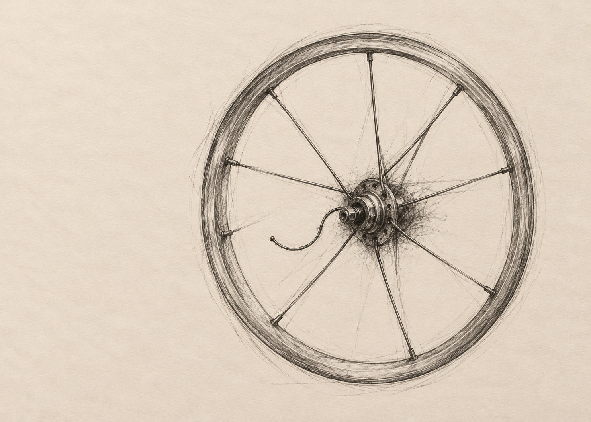 | 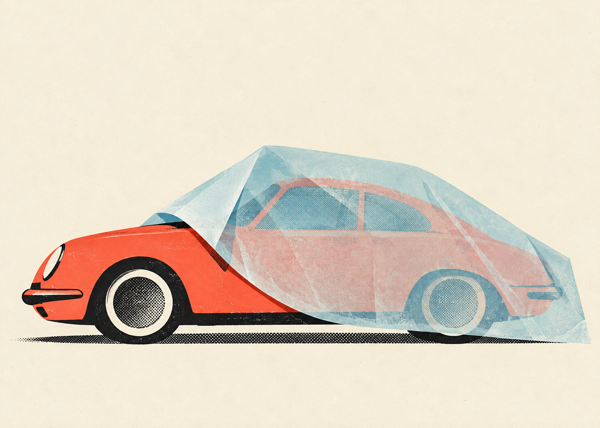 |
| 흑연 드로잉 · 가벼워진 바퀴 | 팝아트 실크스크린 · 공개 전의 차 |
| 수정 1회 · [평가 기록](reviews/P01-02-B.json) | 수정 0회 · [평가 기록](reviews/A01-06.json) |

| 문서화 · 비개발 직군 협업 · P01-02-F |   |
|---|---|
| 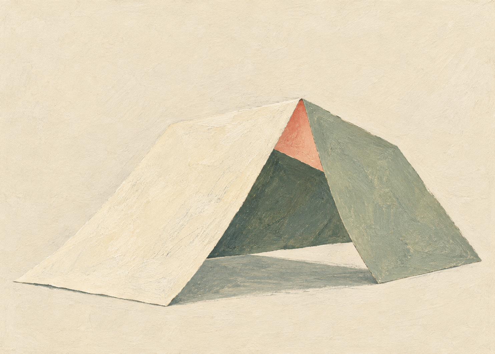 |   |
| 과슈·색연필 · 함께 펴는 한 장 |   |
| 수정 0회 · [평가 기록](reviews/P01-02-F.json) |   |

## 02 시스템과 개발 프로세스

| 문서 통합 관리 서비스 · A02-01 | NestJS 학습 · A02-02 |
|---|---|
|  |  |
| 수채화 · 한 폭으로 모인 실 | 색연필 · 세 가닥의 매듭 |
| 수정 1회 · [평가 기록](reviews/A02-01.json) | 수정 0회 · [평가 기록](reviews/A02-02.json) |

| 반복 작업을 SKILL로 만드는 법 · P02-01-F | 요구사항 게이트 하네스 · A02-03 |
|---|---|
| 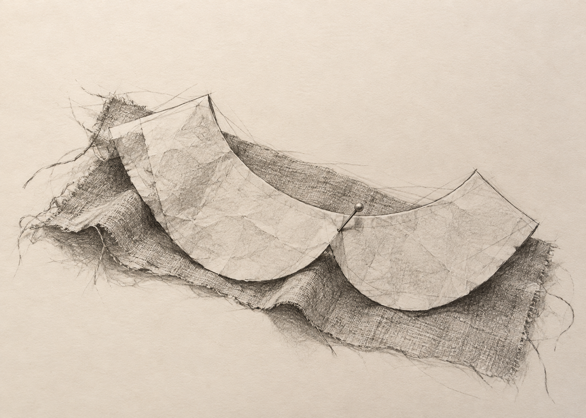 | 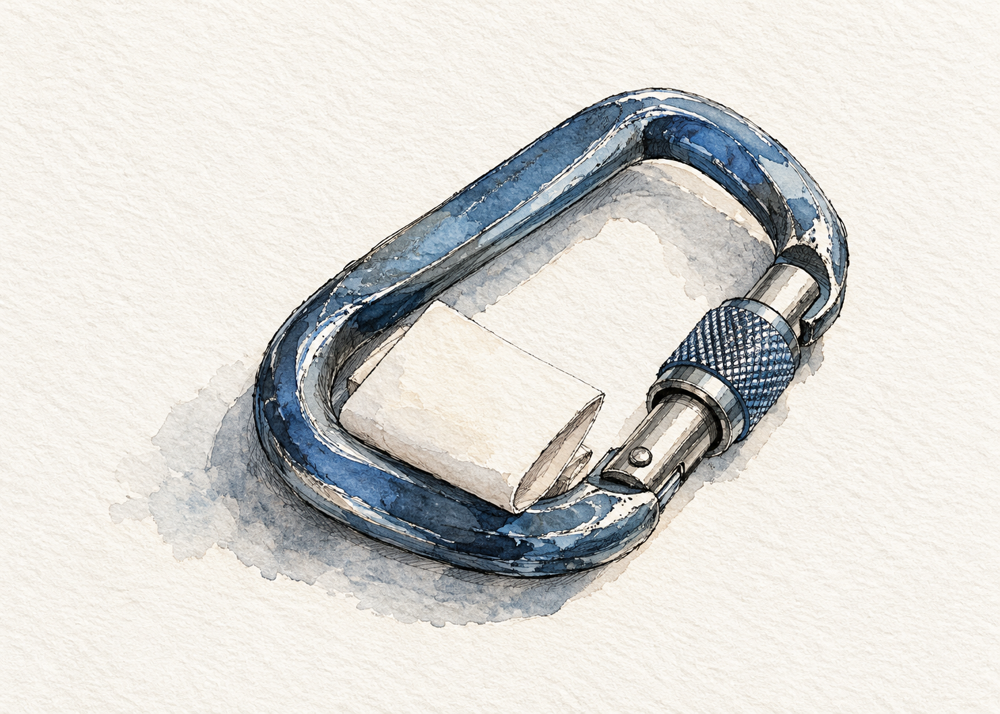 |
| 흑연 드로잉 · 다시 쓰는 옷깃의 본 | 펜·수채화 · 닫힌 카라비너 |
| 수정 0회 · [평가 기록](reviews/P02-01-F.json) | 수정 0회 · [평가 기록](reviews/A02-03.json) |

| AI 개발 파이프라인 · A02-04 | 비개발자용 에이전트 IDE · P02-03-F |
|---|---|
| 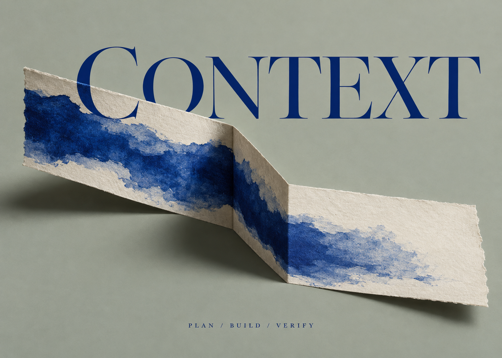 |  |
| 에디토리얼 포스터 · 맥락을 잇는 종이 | 타이포그래피 포스터 · 역할을 조율하는 지휘봉 |
| 수정 0회 · [평가 기록](reviews/A02-04.json) | 수정 0회 · [평가 기록](reviews/P02-03-F.json) |

| TOPIK AI 검증 하네스 · A02-05 | Planit AI 기획 워크스페이스 · A02-END |
|---|---|
|  | 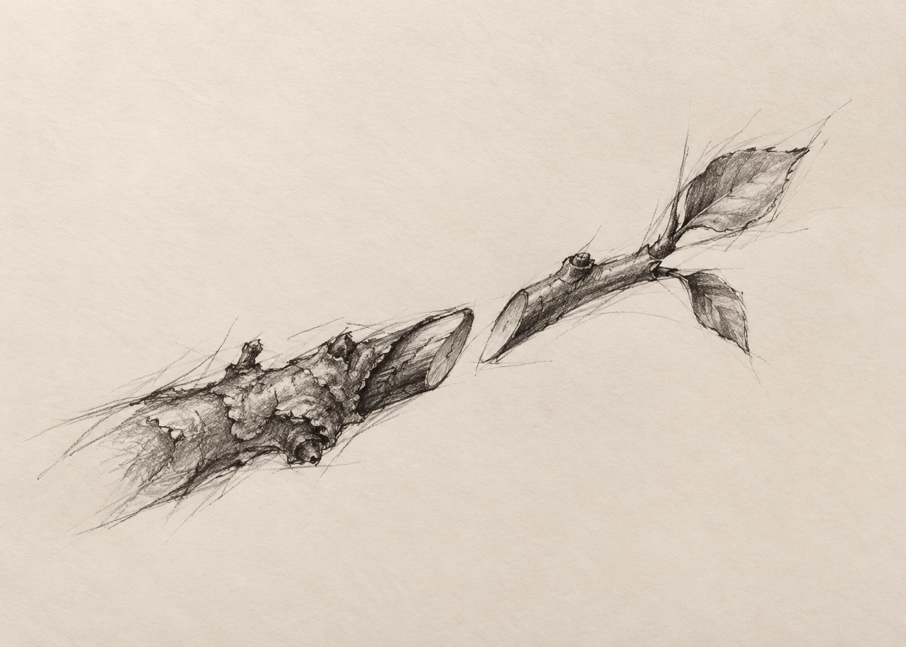 |
| 흑연 드로잉 · 엇갈림을 살피는 렌즈 | 흑연 드로잉 · 맞대기 전의 두 가지 |
| 수정 1회 · [평가 기록](reviews/A02-05.json) | 수정 0회 · [평가 기록](reviews/A02-END.json) |

| StoryQuest 콘텐츠 CMS · A02-10 | 검사 가능한 AI 영상 제작 루프 · P02-04-F |
|---|---|
| 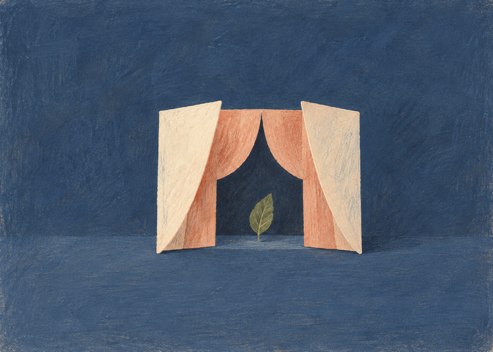 |  |
| 과슈·색연필 · 막 안의 작은 잎 | 타이포그래피 포스터 · 끊기지 않는 필름 |
| 수정 0회 · [평가 기록](reviews/A02-10.json) | 수정 0회 · [평가 기록](reviews/P02-04-F.json) |

| VIVE 독서 보조 도구 · A02-09 | 자동매매 시스템 · A02-08 |
|---|---|
|  |  |
| 펜화 · 책에 남긴 꽃 | 타이포그래피 포스터 · 관찰과 시험의 기록 |
| 수정 0회 · [평가 기록](reviews/A02-09.json) | 수정 0회 · [평가 기록](reviews/A02-08.json) |

| Figma → React 생성기 · A02-07 | 디자인 룰북 · A02-06 |
|---|---|
| 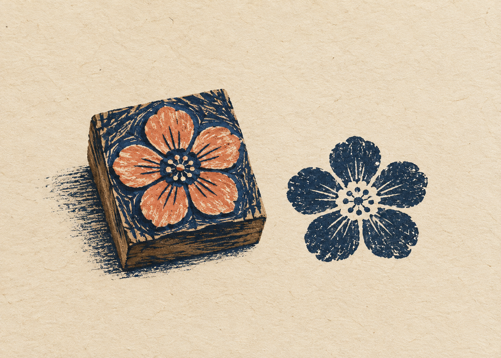 | 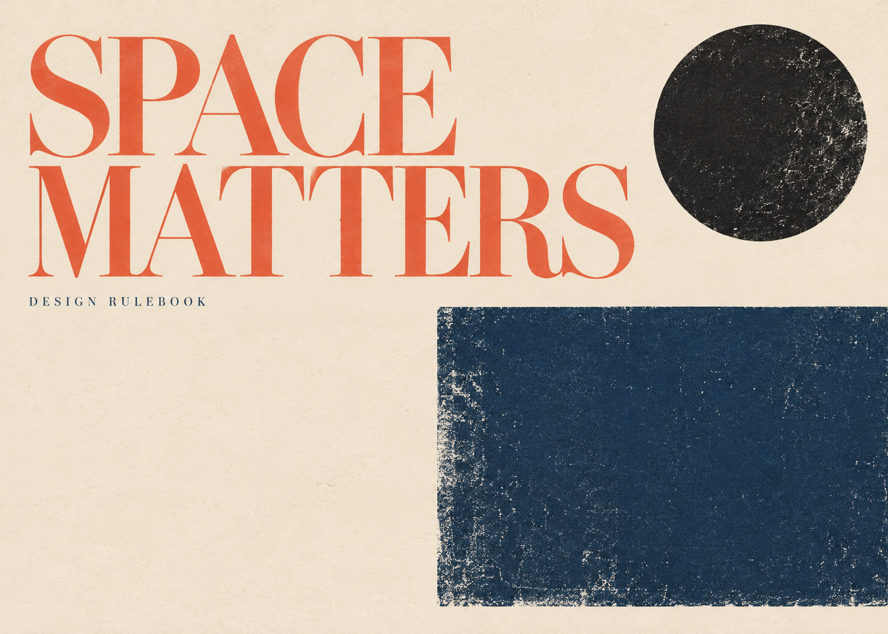 |
| 목판화 · 원판과 한 번의 인쇄 | 타이포그래피 포스터 · 여백의 기준 |
| 수정 0회 · [평가 기록](reviews/A02-07.json) | 수정 0회 · [평가 기록](reviews/A02-06.json) |

## 03 인터랙션과 실험

| 이전 포트폴리오 경력 지도 · A03-01 | 캔버스 여러 개 · V01 |
|---|---|
|  | 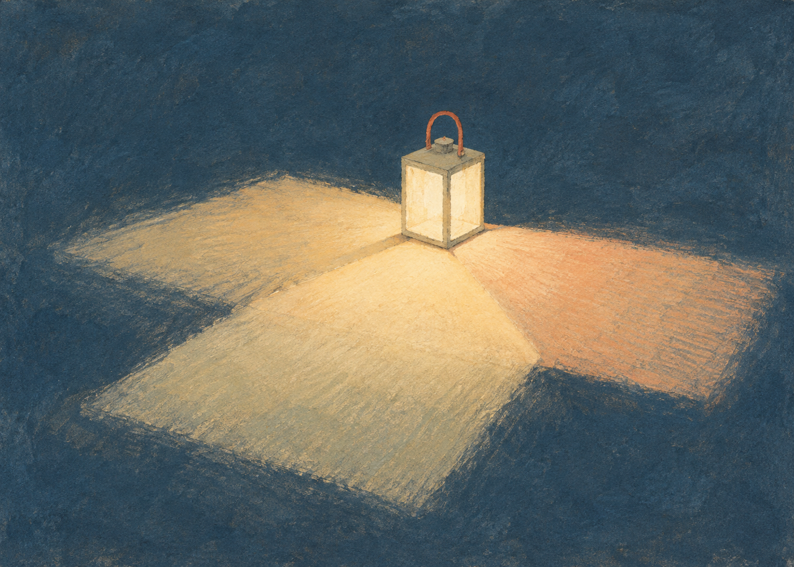 |
| 펜·수채화 · 이어지는 길 | 과슈·색연필 · 한 등불의 여러 빛 |
| 수정 0회 · [평가 기록](reviews/A03-01.json) | 수정 0회 · [평가 기록](reviews/V01.json) |

| 캔버스 · 파티클 · A03-02 | 스크롤 연동 3D · V02 |
|---|---|
|  |  |
| 추상 회화 · 붓의 흐름과 점 | 과슈·색연필 · 말린 종이의 깊이 |
| 수정 0회 · [평가 기록](reviews/A03-02.json) | 수정 1회 · [평가 기록](reviews/V02.json) |

| 물체 감지 · A03-03 | 3D · 아이소메트릭 · V03 |
|---|---|
| 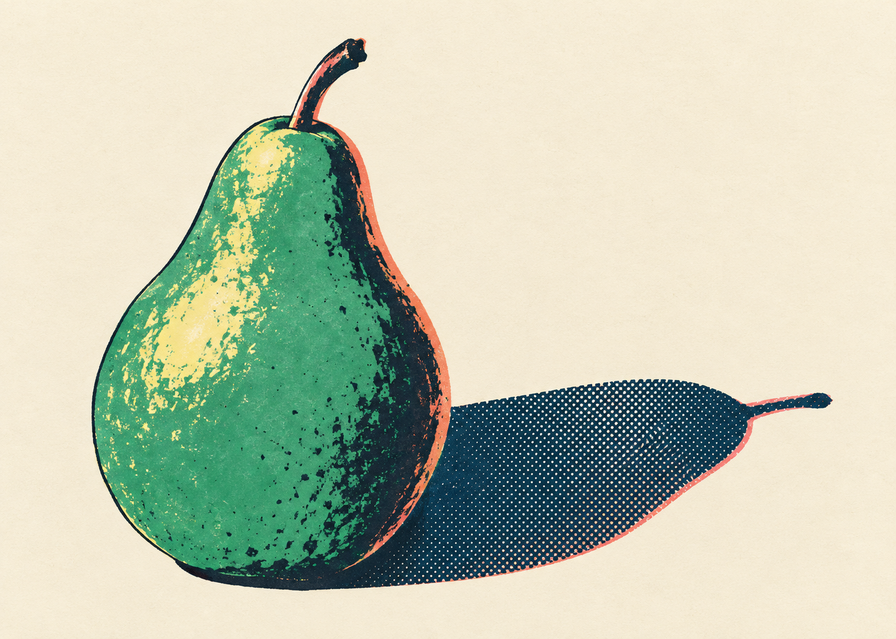 | 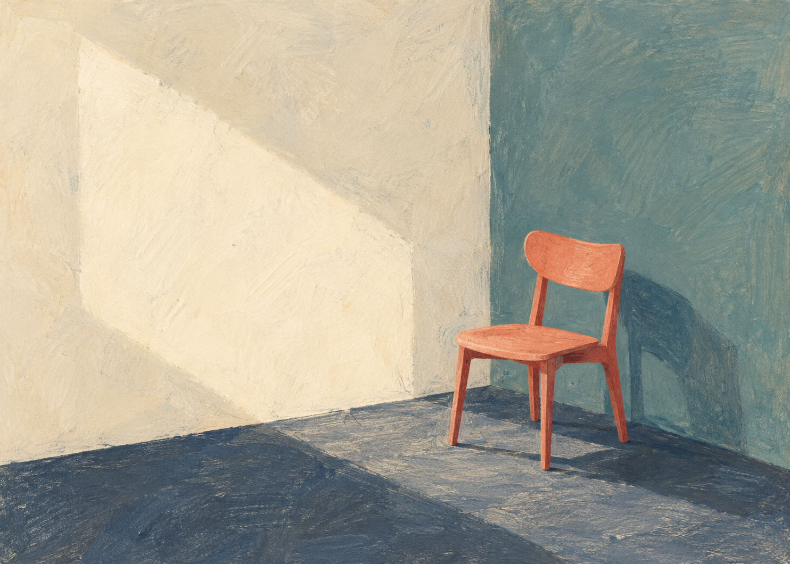 |
| 팝아트 실크스크린 · 형태를 알아보는 배 | 과슈·색연필 · 작은 방의 시점 |
| 수정 0회 · [평가 기록](reviews/A03-03.json) | 수정 0회 · [평가 기록](reviews/V03.json) |

| 포켓몬 도감 · A03-04 | 3D 공간 만들기 · V04 |
|---|---|
|  | 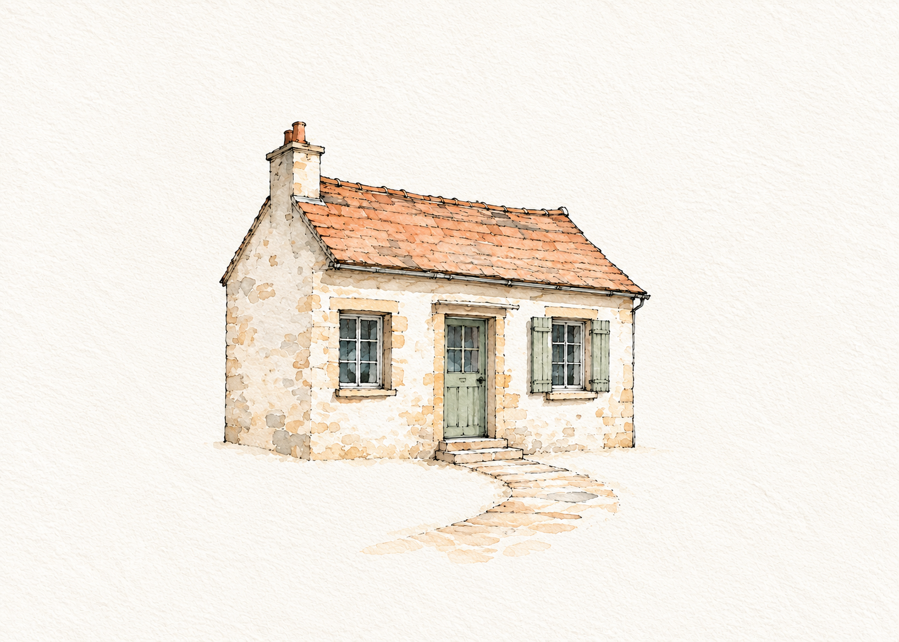 |
| 팝아트 실크스크린 · 수집을 여는 캡슐 | 펜·수채화 · 처음 세운 집 |
| 수정 0회 · [평가 기록](reviews/A03-04.json) | 수정 1회 · [평가 기록](reviews/V04.json) |

| 능력치 카드 게임 · A03-05 | 3D 포트폴리오 구현 · V05 |
|---|---|
|  |  |
| 실크스크린 팝아트 · 내 얼굴의 게임 카드 | 타이포그래피 포스터 · 걸어 들어갈 공간 |
| 수정 0회 · [평가 기록](reviews/A03-05.json) | 수정 0회 · [평가 기록](reviews/V05.json) |

| React 학습기 · A03-END | On the Book · 도서 목록·상세 · V10 |
|---|---|
| 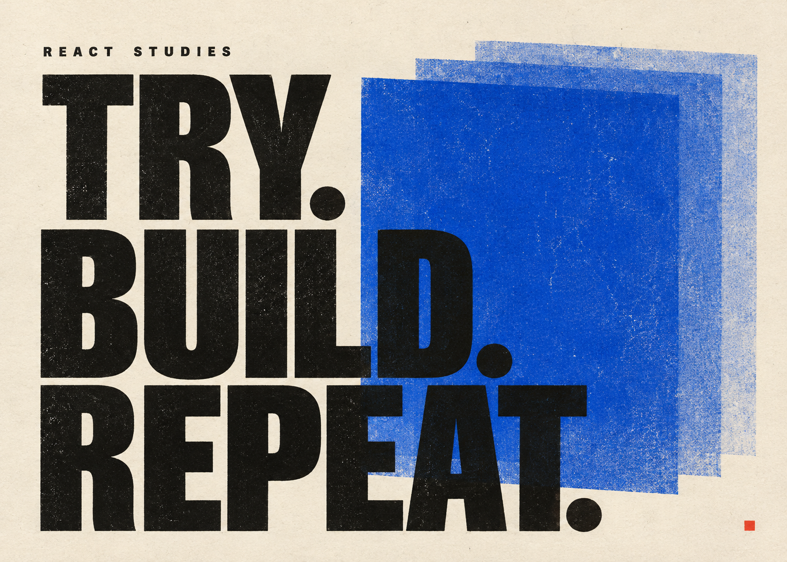 |  |
| 타이포그래피 포스터 · 시도하고 만들고 반복하기 | 과슈·색연필 · 책을 고른 자리 |
| 수정 0회 · [평가 기록](reviews/A03-END.json) | 수정 0회 · [평가 기록](reviews/V10.json) |

| On the Book · 책 속 3D 장면 · V09 | On the Book · 관리 도구 · V08 |
|---|---|
|  |  |
| 초현실 회화 · 계단이 되는 책장 | 타이포그래피 포스터 · 초안에서 공개까지 |
| 수정 0회 · [평가 기록](reviews/V09.json) | 수정 0회 · [평가 기록](reviews/V08.json) |

| 게임 · 인터랙션 · V07 | 게임 · 인터랙션 · V06 |
|---|---|
| 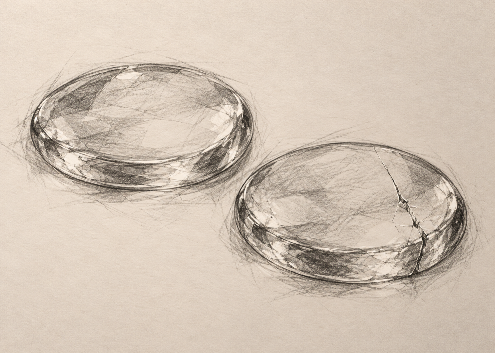 |  |
| 흑연 드로잉 · 다음 발판의 선택 | 코믹 팝아트 · 타격 순간의 주먹 |
| 수정 0회 · [평가 기록](reviews/V07.json) | 수정 0회 · [평가 기록](reviews/V06.json) |

## 검토 범위

49개 위치와 95개 프로젝트·사례 항목의 매핑을 보존했다. 최종 파일은 서로 다른 49장이고, 이미지와 평가 기록의 누락이 없다. 모든 원본은 1484×1060이며 수정 후에도 7:5 비율을 확인했다. 프레임 제거와 상세 보기의 화면 맞춤은 적용 사양으로 기록했으며 런타임 구현 검증은 아직 하지 않았다.
